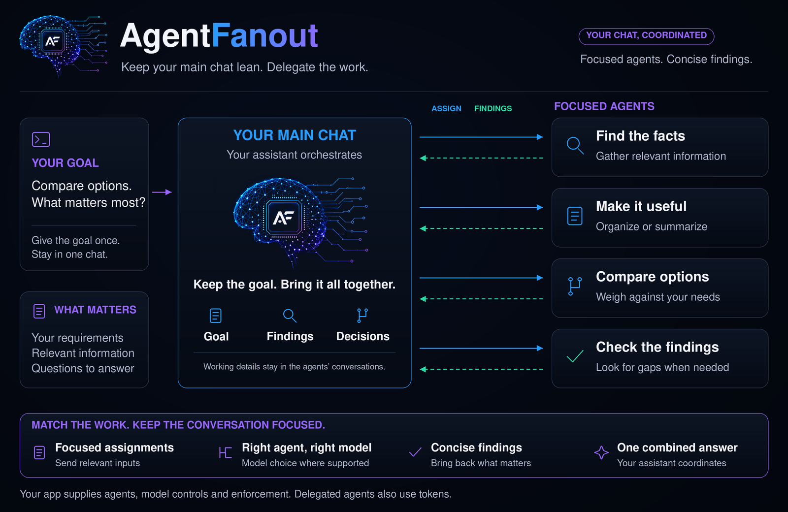

# AgentFanout

**Keep your main chat lean. Use the right agent for the job.**

Long AI conversations fill up with searches, notes, and intermediate work.
When the app compresses that history, useful details can get lost. Meanwhile,
simple tasks can consume the same expensive reasoning you need for harder decisions.

AgentFanout gives your main assistant the job of an orchestrator: break the work
into focused tasks, delegate them to appropriate agents, and bring back concise
findings. Keep the goal, important decisions, and final answer in your main chat.
Let the working details stay in the agents' conversations.



## Why use it?

### Leave room for the conversation

A search can produce pages of material even when the useful answer is three
sentences. AgentFanout asks workers to do that background work separately and
return the findings, sources, and unresolved questions your main assistant needs.
This limits what is brought back into the main chat and reduces context buildup.

### Save stronger reasoning for harder work

A straightforward lookup, extraction, or summary may need a different agent and
model from a difficult judgment. AgentFanout's routing policy matches work to
eligible capabilities instead of treating every task as equally demanding.
Where your app supports and confirms model choice, lighter work can use a lighter
model while harder work gets stronger reasoning.

### Get one coordinated answer

You give the goal once. The main assistant assigns independent work, checks the
returned findings, and follows up on gaps. You stay in one conversation instead
of managing a separate chat for every part of the job.

## What that looks like

```text
AgentFanout compare these three workshop plans against my requirements.
Have agents check the schedule, compare the resources needed, and flag gaps.
Bring back a concise comparison with sources and unresolved questions.
```

The same pattern can help with document summaries, option comparisons, planning,
organizing information, or a second check of a draft. Choose independent tasks
that can return useful findings. Simple questions stay in the main conversation.


1. **Set the goal.** Tell your main assistant what you need and what matters.
2. **Delegate focused work.** Agents get bounded assignments and work in parallel
   when the parts are independent.
3. **Bring back what matters.** The assistant reviews findings, asks for follow-up
   when needed, and gives you a combined answer or explains what remains blocked.

## Tokens, usage, and context compression

AgentFanout addresses two different sources of waste: putting every working detail
into your main chat, and using more model capability than a task requires.

Keeping worker conversations separate and asking for short results helps leave
room in the main chat. Your app still controls its context window and compression;
AgentFanout does not expand that window or guarantee compression never happens.

Delegated agents also use tokens. Total usage depends on task size, model choice,
repeated instructions, retries, and checks. Matching a task to a suitable lower-cost
model can reduce that task's model cost where supported. **Net token or money
savings have not been established by a controlled AgentFanout benchmark.**

The default skill guides orchestration. It can request model or reasoning choices
only when the app exposes them; it cannot manufacture those controls. See
[model selection and accounting](references/CostPolicy.md) for the detailed policy.

## Get started

Use AgentFanout inside an AI app that supports skill discovery and native agents.
The default is a small Markdown skill; Python and a separate runtime are optional.

### 1. Install the lightweight skill

From a reviewed checkout, copy these six files into your app's skill directory
under `agent-fanout/`, keeping their relative paths:

```text
agent-fanout/
├── SKILL.md
├── agents/openai.yaml
├── workflows/Activate.md
├── workflows/Wave.md
├── references/ParentBoundary.md
└── references/WhenNotToFanout.md
```

This profile needs no Python, Bun, provider credential, or Linux-specific component.
It adds no AgentFanout-specific global startup instructions. The app supplies the
agents, their permissions, and any model-selection controls.

### 2. Ask for a task

Start with non-sensitive sample material and an independent multi-part request,
such as the workshop-plan example above. Use `AgentFanout Status`,
`AgentFanout Help`, or `AgentFanout Cancel` for the active task. Cancellation stops
new assignments and requests cancellation of active agents where the app supports it;
it does not prove that remote work has stopped.

`AgentFanout Codex|Grok|Local <task>` requests a provider preference for one task.
It depends on available, verified host capabilities and does not authorize spending
or change how later unrelated conversations run.

## Optional integrations

- **Native skill — default.** Small, portable instructions for delegation and
  concise results. The app supplies agents and enforcement.
- **Codex plugin — optional.** Adds tracking and guards for supported hook events.
  Requires Python 3.9+, Codex plugin discovery, hooks, and native multi-agent
  support. Hook coverage is incomplete; compatibility must be checked on your host.
- **Strict runtime — optional.** Adds controlled hosted execution, validated
  receipts, accounting, and recovery. Requires Linux/POSIX, Python 3.11+, an
  isolated environment, locked dependencies, exact project binding, and verified
  provider evidence. It governs the work it launches.

Grok native integration is experimental. GrokCLI subscription, coordinator-backed
Local, and mixed hosted runs are disabled candidates. All six upgrade controls
remain off; retained sessions and tool-capable upgrade workers are deferred.
The deployment-specific coordinator is external to this repository. Hosted and
native/V2 contracts remain separate.

See the [profile guide](docs/profile-guide.md) for installation and compatibility,
and [feature status](docs/candidate-status.md) for implemented, experimental,
and unavailable behavior.

## Safety and limitations

Keep private account tools, credentials, Git changes, destructive actions, and
final decisions with the main assistant and host. Worker text cannot grant
launch, model, usage, or spending authority. The native skill supplies guidance;
stronger enforcement requires independently verified host controls.

Agents can make mistakes. Concise findings still need evidence and review.
A completed task batch, plugin completion marker, or `Stop` hook does not prove
that the overall job is correct or finished. Checks are conditional on risk and
uncertainty; small, low-risk tasks do not automatically need another agent.

Bounded prompts and known-pattern screening are not data-loss prevention. An empty
MCP list, read-only instruction, or sandbox label does not prove tool isolation.
No-tool helpers are not a complete OS sandbox against malicious same-user processes.

The strict runtime blocks when required checks fail, limits are exhausted, usage
is missing, or effects remain uncertain. It does not silently switch providers.
Unknown effects retain reservations and block replay or terminal success. Recovery
preserves compatible runtimes and immutable history. Authentication establishes
neither included allowance nor permission to spend; provider costs may be unknown.

Read [Security](SECURITY.md), [host controls](references/HostEnforcement.md),
and [recovery and cancellation](docs/profile-guide.md#validation-failure-and-recovery)
before adopting stronger integrations. Offline tests do not establish current live
model support or production readiness.

[Support](SUPPORT.md) · [Contributing](CONTRIBUTING.md) · [Release process](docs/release-process.md) ·
[MIT license](LICENSE) · [Image provenance](assets/README.md)
