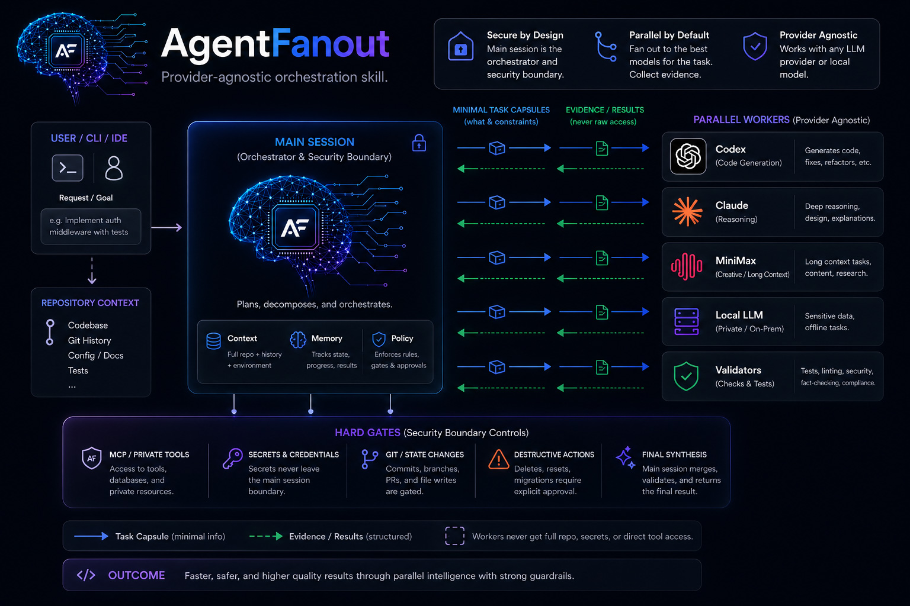
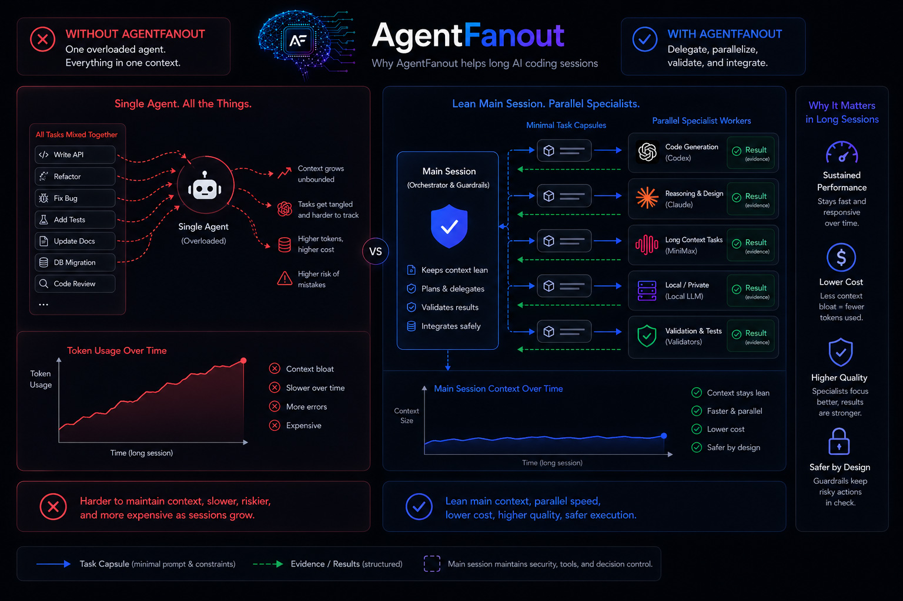
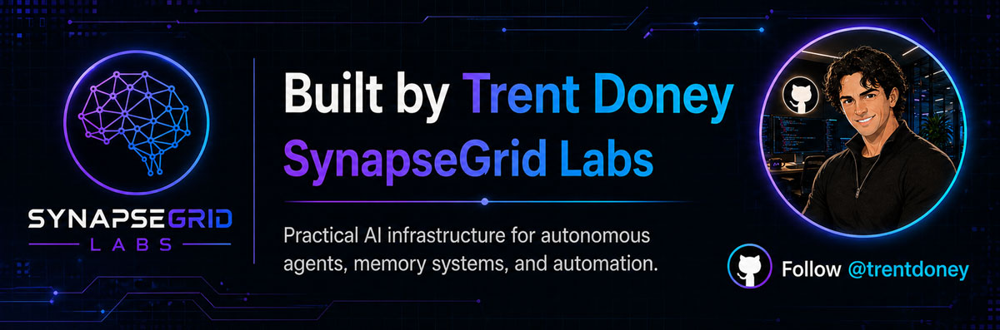

# AgentFanout

[](https://github.com/SynapseGrid-Labs/AgentFanout/actions/workflows/ci.yml)
[](LICENSE)
[](https://github.com/SynapseGrid-Labs/AgentFanout/releases)
[](.github/workflows/ci.yml)
[](SECURITY.md)

AgentFanout is a provider-agnostic orchestration skill and advisory router for safe multi-agent work. It keeps the main session in charge of safety, private tools, git state, destructive actions, and final synthesis while allowing host runtimes to use bounded workers and validators when fanout is worth the overhead.

Canonical project page: [synapsegridlabs.com/agentfanout](https://synapsegridlabs.com/agentfanout/)



The diagrams show the intended orchestration flow. Worker launch is performed by the host runtime; AgentFanout provides routing policy, task packets, safety gates, and validation rules.

## Current Status

AgentFanout is `v0.1.1`. It is a portable skill/policy layer and deterministic advisory router, not a standalone dispatch harness. It is designed to be embedded into agent runtimes that already have a worker mechanism, such as Codex subagents, Claude agents, MiniMax wrappers, local LLM runners, or future provider adapters.

## Public Release Gate

AgentFanout is public-facing. Maintainer-originated GitHub-facing changes are treated as release work, not scratch-pad updates. Maintainers must complete the local source review gate and full security audit described in [Release Process](docs/release-process.md) before creating or updating any GitHub-facing branch, pull request, tag, release, or public export.

## Table of Contents

- [Execution Model](#execution-model)
- [Public Release Gate](#public-release-gate)
- [Who This Is For](#who-this-is-for)
- [What It Does](#what-it-does)
- [What This Is Not](#what-this-is-not)
- [Quickstart](#quickstart)
- [Deterministic Router](#deterministic-router)
- [Safety Model](#safety-model)
- [Support and Contact](#support-and-contact)
- [Release Process](docs/release-process.md)
- [FAQ](#faq)

## What Is AgentFanout?

AgentFanout is a safe multi-agent routing layer for host runtimes. It classifies work, applies hard safety gates, shapes compact worker packets, recommends provider routing, and requires validation when fanout is useful. AgentFanout does not launch workers by itself; the host runtime remains responsible for execution.

## Execution Model

- **Skill Mode:** The host agent uses AgentFanout instructions to decompose, delegate, validate, and integrate work.
- **Worker-First Mode:** Broad investigations, repo searches, infrastructure research, and multi-surface debugging should launch scoped workers before the main session starts collecting evidence.
- **Router Mode:** `scripts/route.py` returns advisory JSON, dispatch requirements, and sanitization output. It does not launch workers by itself.
- **Harness Mode:** A standalone dispatcher is possible future infrastructure. It is not currently shipped.

If `scripts/route.py` reports `dispatch.status=launch_required`, the host runtime should launch workers using its native mechanism before substantive main-session research. While workers run, the main session should coordinate, wait, validate, and integrate rather than duplicate the workers' SSH diagnostics, filesystem sweeps, repo-wide search, or substantive research. If no worker mechanism is available, hosts should surface `fanout_blocked` rather than silently falling back to main-session-only work.

## Who This Is For

AgentFanout is for people building or operating agent workflows that need:

- bounded fanout across coding, review, research, validation, or extraction tasks
- strict separation between the main session and worker prompts
- provider-agnostic routing across current and future agent runtimes
- small worker packets that reduce main-session context growth
- explicit safety gates for secrets, private tools, git state, destructive actions, and final synthesis

## What It Does

- Routes work between the main session, Codex, Claude, MiniMax, local LLMs, or future providers.
- Uses automatic guarded fanout instead of a fixed worker-count command.
- Gives each worker a compact specialist capsule by default.
- Loads richer agent/persona context only when the request actually needs it.
- Sanitizes delegated prompts so voice, callback, webhook, and notification behavior cannot leak into workers.
- Treats legacy `AgentOrchestrator` and `OrchestratorMode` phrases as compatibility hints, not global policy.

## What This Is Not

AgentFanout does not currently provide:

- a standalone worker dispatcher
- subprocess orchestration
- concurrency caps
- endpoint probing or API-key validation
- worker timeout/cancellation management
- result collection from external runtimes

Those capabilities belong in a future optional harness or in the host runtime.

## Why It Helps



AgentFanout keeps the main session's context focused by shaping small, bounded worker packets. When the host runtime supports worker execution, it sends those packets to workers; the main session receives evidence and validated results back, then performs the final integration.

## Quickstart

Copy this repository into your runtime skill root:

```bash
mkdir -p "${PAI_DIR:-$HOME/.pai}/skills"
cp -R AgentFanout "${PAI_DIR:-$HOME/.pai}/skills/AgentFanout"
```

If your runtime supports a skill registry, regenerate it after copying the skill.

Run the advisory router directly:

```bash
python3 scripts/route.py "review twenty independent modules"
python3 scripts/route.py "AgentFanout Status"
python3 scripts/route.py --sanitize "prompt text"
```

## Deterministic Router

`scripts/route.py` classifies a request, checks hard gates, selects a provider preference, estimates useful fanout, returns a worker capsule, reports dispatch requirements, and reports validator requirements.

Example output shape:

```json
{
  "route": {
    "task_class": "bulk-read",
    "worth_delegating": true,
    "parallelism": "parallel",
    "executor": {
      "role": "explorer",
      "provider": "MiniMax",
      "model_selector": "minimax-latest",
      "reasoning_effort": "low"
    }
  },
  "fanout": {
    "policy": "automatic_guarded",
    "planned_workers": 20
  },
  "dispatch": {
    "status": "launch_required",
    "main_session_policy": "coordinate_wait_integrate",
    "launch_before_main_research": true,
    "main_session_may_duplicate_worker_research": false,
    "fallback_allowed": false
  },
  "validator": {
    "required": true
  }
}
```

Provider readiness is environment-driven:

```bash
AGENT_FANOUT_MINIMAX_AVAILABLE=1
AGENT_FANOUT_LOCAL_AVAILABLE=1
AGENT_FANOUT_CODEX_SUBAGENTS=1
AGENT_FANOUT_CLAUDE_AVAILABLE=1
```

The router also checks `$PAI_DIR/skills/MiniMax/Tools/MiniMaxExec.ts` or `$PAI_HOME/skills/MiniMax/Tools/MiniMaxExec.ts` for MiniMax readiness, falling back to `~/.pai/skills/...`.

Readiness flags and file checks are routing hints. They do not perform live endpoint probing, key validation, or health checks.

MiniMax highspeed is not assumed. AgentFanout uses the default supported MiniMax selector unless the host runtime has verified that the active token plan supports highspeed mode.

## Safety Model

The main session always owns:

- MCP/private-account tools
- secrets and credentials
- git state changes
- destructive or irreversible actions
- final synthesis and user-facing conclusions

Suspicious credential-shaped prompts remain main-session-only even when they do not use words like "secret" or "token".

Workers receive only bounded task packets. They must return results to the main session and must not contact notification hooks, voice systems, webhooks, or callback URLs.

Read-only research workers may use scoped read-only retrieval and diagnostics when assigned by the host: repo/file reads, filesystem search, runtime-approved knowledge-base retrieval, public web or docs research, read-only SSH diagnostics, and read-only database queries where configured. That read-only scope does not include private-account side effects, secrets, git mutations, destructive actions, or final synthesis.

## Support and Contact

- Project page: [synapsegridlabs.com/agentfanout](https://synapsegridlabs.com/agentfanout/)
- Contact page: [synapsegridlabs.com/contact](https://synapsegridlabs.com/contact/)
- Usage questions, documentation gaps, routing bugs, and adapter suggestions: [GitHub Issues](https://github.com/SynapseGrid-Labs/AgentFanout/issues)
- Support policy: [SUPPORT.md](SUPPORT.md)
- Security reporting: [SECURITY.md](SECURITY.md)

Do not post secrets, credentials, private infrastructure details, or harmful exploit payloads in public issues.

## Commands

Only exact full-line `AgentFanout ...` commands mutate session state:

- `AgentFanout Status`
- `AgentFanout Help`
- `AgentFanout MiniMax`
- `AgentFanout Local`
- `AgentFanout Codex`
- `AgentFanout Claude`
- `AgentFanout HIGH`
- `AgentFanout Auto`
- `AgentFanout Clear`
- `AgentFanout Reset`

Fanout size is automatic. AgentFanout estimates independent work units, provider readiness, validation overhead, write-scope conflicts, and hard gates.

## Tests

```bash
python3 tests/run_tests.py
python3 -m py_compile scripts/route.py tests/run_tests.py
scripts/github-preflight.sh
```

## Repository Layout

- `SKILL.md`: primary skill instructions
- `scripts/route.py`: deterministic advisory router and sanitizer
- `references/`: routing, safety, provider, validator, and token policy references
- `adapters/`: provider-specific adapter contracts
- `workflows/`: activation, routing, and validation workflows
- `tests/`: fixture-based router tests

## FAQ

<details>
<summary>Is AgentFanout a standalone orchestrator?</summary>

No. AgentFanout is a portable skill and policy layer. It provides advisory routing via `scripts/route.py` and integration instructions for host runtimes, but it does not launch workers or manage dispatch queues.

</details>

<details>
<summary>Is this just regex routing?</summary>

No. `scripts/route.py` uses deterministic cues and regexes as one input, then applies task classification, hard safety gates, provider selection, worker capsule shaping, and validation policy. It returns an advisory route; the host runtime executes it.

</details>

<details>
<summary>Who actually launches the workers?</summary>

The host runtime launches workers using its native mechanism, such as Codex subagents, Claude agents, a MiniMax wrapper, a local LLM runner, or a future optional harness.

</details>

<details>
<summary>What happens if AgentFanout wants workers but none are available?</summary>

The route should surface `fanout_blocked`. The host should report that worker launch is unavailable instead of letting the main session quietly perform the whole broad investigation.

</details>

<details>
<summary>What does <code>route.py</code> actually do?</summary>

`scripts/route.py` returns advisory JSON for routing, mode state, worker capsules, validator requirements, warnings, and prompt sanitization. It does not dispatch workers, enforce concurrency, apply timeouts, or collect worker results.

</details>

<details>
<summary>Why not ship a full harness now?</summary>

AgentFanout is designed to be host-runtime agnostic. Shipping a dispatcher would add implementation assumptions that reduce portability. A harness can be added later as an optional layer.

</details>

<details>
<summary>What remains main-session only?</summary>

MCP/private tools, secrets, git state changes, destructive actions, authenticated calls, and final synthesis remain in the main session.

</details>

<details>
<summary>Will there be a future harness?</summary>

Possibly. A future optional harness could add provider probes, key and endpoint checks, concurrency caps, timeouts, retries, cancellation, and normalized result capture.

</details>

## Maintainer

[](https://github.com/trentdoney)

See [CONTRIBUTORS.md](CONTRIBUTORS.md) for contributor attribution.
